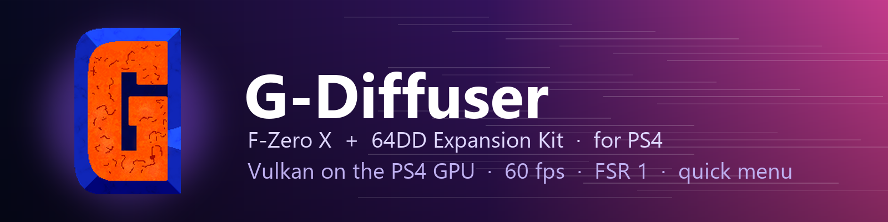

<p align="center">
  
</p>

<p align="center">
  
  
  
  <a href="https://github.com/Zorkats/G-Diffuser/blob/main/LICENSE"></a>
</p>

<h3 align="center">F-Zero X, at 60 fps, on the PS4.</h3>

<p align="center">
  <a href="#getting-started"><b>Getting started</b></a> ·
  <a href="#controls">Controls</a> ·
  <a href="#what-works">What works</a> ·
  <a href="#faq">FAQ</a> ·
  <a href="#building-it-yourself">Building</a> ·
  <a href="#thanks">Thanks</a>
</p>

---

## Overview

This is [G-Diffuser](https://github.com/Zorkats/G-Diffuser), the native PC port of **F-Zero X** and
its **64DD Expansion Kit**, rebuilt as an app for jailbroken PS4 consoles. It isn't an emulator:
the game's decompiled code runs directly on the PS4's CPU, and every frame is drawn with Vulkan on
the PS4's own GPU (Mesa's RADV driver, adapted to submit work straight to the console's AMD GPU,
the same driver behind [Dolphin for PS4](https://github.com/iHaiDeeZ/DolphinPS4)).

You get the whole of F-Zero X plus the Expansion Kit's courses and modes, at 1080p and around
60 fps, with a DualShock 4. Clicking the touchpad pauses the game behind a quick menu with every
one of G-Diffuser's settings and enhancements.

You bring your own game. Nothing copyrighted is bundled: the game data is built on your PC from
your own ROM, disk image and 64DD IPL, then packaged for your console only.

## Highlights

**A quick menu on the touchpad**
- Click the touchpad (or press **L3 + R3**) and the game pauses behind a PS3-style side panel.
- Resume, reset the game, change the volume, show the FPS counter, switch widescreen, or quit.
- **Settings** and **Enhancements** open every page of G-Diffuser's own options, right in the
  menu: graphics, shaders, audio, visuals, gameplay, practice, ghosts, cosmetics, achievements and
  more. **L1 / R1** change page, **Left / Right** change a value.

**Built for the PS4's hardware**
- A Vulkan renderer written for this port, drawing on the PS4's GPU through RADV and presenting
  through VideoOut, with shader and pipeline caches kept between sessions.
- **FSR 1.0**: AMD FidelityFX Super Resolution renders at 77, 67, 59 or 50% and upscales to
  1080p with edge-aware filtering and sharpening, for extra headroom. Off by default.
- The full 16:9 screen: the N64's black overscan border is removed by default.
- Native audio through the PS4's own audio output, and the DualShock 4 mapped out of the box.

**The whole game**
- Grand Prix, Time Attack, Death Race and the Expansion Kit's extra cups and courses.
- G-Diffuser's widescreen, HUD options, draw distance, machine detail, texture filtering, lap
  deltas, photo mode and the rest of its enhancements.
- Saves carry over from the PC version.

## Getting started

**You need:** a jailbroken PS4 with **GoldHEN**, an FTP connection to it, a Windows PC, and your
own copies of:

- **F-Zero X (USA)** as a `.z64` ROM
- the **F-Zero X Expansion Kit** disk image (`.ndd`)
- the **64DD IPL** (USA, `64DD_IPL_US_MJR.n64`), not the Japanese one

1. **Build the game data on your PC.** Download [G-Diffuser](https://github.com/Zorkats/G-Diffuser)
   for Windows, put your three files next to it and start it once. Its first boot builds
   `fzerox.o2r`, `fzerox-disk.o2r` and `n64ddipl.o2r`, plus two small state files. Check that the
   game runs on the PC.
2. **Build the PS4 package** with that folder as the game data: see
   [Building it yourself](#building-it-yourself). The package carries data made from your ROM,
   so it is for your console only: please don't share it.
3. **Install** `G-Diffuser-PS4-vXX.XX.pkg` with GoldHEN's **Package Installer**.
4. **Start G-Diffuser** from the home screen. The first launch copies the game data to
   `/data/gdiffuser/`; later launches go straight in.

**Updating:** install the newer package on top of the old one. Your settings and saves live in
`/data/gdiffuser/` and survive updates.

**Bringing PC saves over:** copy the PC folder's `saves/` to `/data/gdiffuser/saves/` over FTP.

## Controls

### While playing

| DualShock 4 | N64 controller |
|---|---|
| Cross | A |
| Circle | B |
| L1 / R1 | L / R |
| L2 or R2 | Z |
| Right stick | C buttons |
| Left stick | Control stick |
| OPTIONS | Start |
| D-pad | D-pad |
| Touchpad click, or L3 + R3 | Open the quick menu |

L and R sit on the bumpers so side attacks (both at once) are easy, and Z is on both triggers.
Buttons can be changed in **Settings → Controls**.

### In the quick menu

| Press | To |
|---|---|
| D-pad / left stick | Move around |
| Cross | Choose |
| Left / Right | Change a value |
| L1 / R1 | Previous / next settings page |
| Circle | Go back, or resume the game |
| Touchpad | Close the menu |

## Settings at a glance

Everything below is in the quick menu under **Settings** and **Enhancements**.

| Page | Highlights |
|---|---|
| Graphics | Internal resolution, **FSR 1.0 upscaling** and sharpness, texture filtering, frame pacing |
| Shaders | G-Diffuser's display shader options |
| Audio | Volume, reverb, low-pass filter, audio buffer |
| Visuals | Widescreen, widescreen HUD, remove black borders, race intro curtain, draw distance, machine detail |
| Gameplay | Skippable transitions, lava without damage, extra gameplay options |
| Practice / Ghosts | Lap deltas, photo mode, ghost options |
| Cosmetics / Achievements | Colours and unlockables tracking |

## Your files

Everything the app creates sits in **`/data/gdiffuser/`**:

- `fzerox.o2r`, `fzerox-disk.o2r`, `n64ddipl.o2r`: your game data, copied from the package
- `saves/`: your save data and the Expansion Kit disk's save
- `gdiffuser.cfg.json`: every setting
- `vulkan-pipeline-cache.bin`: the renderer's cache, so later starts are quicker
- `quickmenu/sounds/`: the quick menu's sounds (WAV, replaceable)
- `boot-trace.log`, `crash.log`: logs for bug reports

## What works

| Status | Meaning |
|---|---|
|  | Tested on a console and works |
|  | Should work, not checked on a console yet |

Tested on a launch-model PS4:

| Status | Part | Notes |
|---|---|---|
|  | Races (Grand Prix) | Around 60 fps at 1080p, with machines, shadows, track, buildings, booster flames and the pit force field |
|  | Menus and machine select | |
|  | HUD | Timer, speed, ranks, energy and the course map |
|  | Quick menu | All Settings and Enhancements pages |
|  | Audio, DualShock 4, saves | |
|  | FSR 1.0 | Checked on a PC; not yet compared on a console |
|  | Course Edit, Create Machine | Expansion Kit editors |
|  | Multiplayer | Split screen with more than one controller |

Found something that looks wrong? [Open an issue](https://github.com/iHaiDeeZ/G-Diffuser-PS4/issues).

## FAQ

**Why isn't there a package to download?**
The package has to carry game data built from the ROM, and that can't be shared. You build the
data from your own files on a PC, then build the package with it.

**Why do I need the US 64DD IPL?**
G-Diffuser builds the Expansion Kit's data with it. The Japanese IPL produces different data.

**Can I run it faster or sharper?**
Under **Settings → Graphics**, *Internal resolution* above 1.00x is sharper but costs GPU time;
**FSR 1.0** modes render lower and upscale, which frees GPU time.

**The first start takes a while.**
The first launch copies about 50 MB of game data and builds the renderer's shaders. Both are kept,
so later starts are quicker.

**How do I report a bug?**
[Open an issue](https://github.com/iHaiDeeZ/G-Diffuser-PS4/issues) with what you did, what you
saw, the version (in the package name), and `boot-trace.log` and `crash.log` from
`/data/gdiffuser/`.

## Good to know

- Only the original PS4 has been tested so far. PS4 Pro reports are welcome.
- Save states aren't supported; the game saves as it normally does, in `/data/gdiffuser/saves/`.
- The PC version's full-screen menu isn't used on the PS4: the quick menu replaces it.

## Building it yourself

The PS4 build lives in WSL and uses [Dolphin for PS4](https://github.com/iHaiDeeZ/DolphinPS4)'s
toolchain (clang 21 and libc++ 21 over the PacBrew OpenOrbis runtime) and its Mesa RADV build.
The changes to G-Diffuser and its submodules are kept here as patches against the revisions in
[`patches/BASE.txt`](patches/BASE.txt).

1. Build DolphinPS4's tree in `~/dolphinps4-build` (`build-libcxx.sh`, `build-runtime.sh`,
   `build-mesa.sh`).
2. Check out G-Diffuser at the revisions in `patches/BASE.txt` into
   `~/gdiffuserps4-build/src/G-Diffuser` and apply `patches/*-ps4.patch` (one per repository).
3. From WSL, through a symlink without spaces (`~/gdiffuserps4` → this folder):

```
scripts/configure-gdx.sh
scripts/build-gdx.sh
GDX_GAME_DATA=/mnt/e/<your PC G-Diffuser folder> scripts/package-gdx.sh [upload]
```

`upload` sends the package to the console's `/data/pkg/` over FTP (`PS4_HOST`, `PS4_FTP_PORT`).
`scripts/save-patch.sh` refreshes the patches from the G-Diffuser tree, and
`tests/run-vk-shader-test.sh 3000` checks that every generated Vulkan shader compiles.

### How it works

- **Renderer:** `libultraship/src/fast/backends/gfx_vulkan.cpp`, a Fast3D Vulkan backend. Three
  linear images are registered as VideoOut buffers and flipped GPU-side. Shaders are the OpenGL
  template rewritten for Vulkan and compiled with glslang on the console. FSR 1.0 is two
  full-screen passes before the frame is composited.
- **Addresses below 4 GiB:** the PS4 loads the program at 0x400000, so the game's own addresses
  can equal N64 segment addresses (0x01xxxxxx to 0x04xxxxxx), which never happens on Windows. The
  display-list bridge and the CPU-side address resolver tell them apart under `GDX_IMAGE_BELOW_4G`.
- **Reproducing PS4 bugs on a PC:** configuring the Windows build with `-DGDX_LOW_IMAGE=ON` links
  it so its image sits where the PS4's does and keeps the heap above 4 GiB, so PS4 rendering bugs
  show up on a PC. `GDX_LOWFIX=<mask>` switches the individual address fixes for bisecting.
- **Audio:** `Ps4AudioPlayer` on `sceAudioOut`, resampling the game's 32 kHz stream to 48 kHz.
- **Scheduler:** `port/gdx_fiber_ps4.c`, an x86-64 context switch (the PS4's libc has no ucontext).

## Thanks

- **[G-Diffuser](https://github.com/Zorkats/G-Diffuser)** by **Vicente Mediano**: the port itself
- The **F-Zero X** and **Expansion Kit** decompilation projects
- **[libultraship](https://github.com/Kenix3/libultraship)** and **Fast3D**: the runtime and renderer core
- **[Mesa](https://mesa3d.org)**: the RADV Vulkan driver that draws every frame
- **[OpenOrbis](https://github.com/OpenOrbis)** and **[PacBrew](https://github.com/PacBrew)**: the PS4 toolchains
- **[GoldHEN](https://github.com/GoldHEN/GoldHEN)**: the homebrew enabler
- **AMD FidelityFX Super Resolution 1.0** (MIT)

## License and disclaimer

G-Diffuser's own code is under the MIT License, and its components keep their own licences: see
G-Diffuser's [LICENSE](https://github.com/Zorkats/G-Diffuser/blob/main/LICENSE) and
`THIRD_PARTY_NOTICES.md`. The changes in `patches/` follow the licence of the file they modify.
The quick menu is adapted from [Resonance](https://github.com/iHaiDeeZ/Resonance).

This is a fan-made project with no ties to Nintendo, Sony Interactive Entertainment or the
G-Diffuser project. F-Zero, Nintendo 64 and 64DD are trademarks of Nintendo; PlayStation and PS4
are trademarks of Sony Interactive Entertainment. Please only play games you own. This project
won't help you find or share game files.
